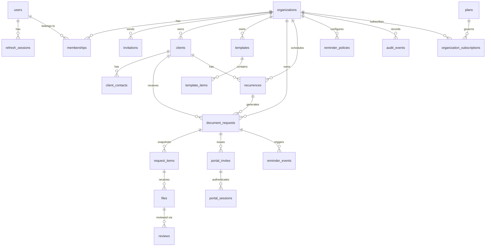

# Database ERD & Migration Strategy — Client Document Chaser

## 1. Design Principles

- **Engine**: PostgreSQL 16 (`pgcrypto` / `gen_random_uuid()`).
- **Primary Keys**: `uuid` on every table.
- **Timestamps**: `timestamptz` (UTC) for `created_at`, `updated_at`, `deleted_at`, and domain timestamps.
- **Tenant Isolation**: Every tenant-owned table includes `organization_id uuid NOT NULL REFERENCES organizations(id)` and composite indexes keyed with `organization_id` first.
- **Soft Deletes**: `deleted_at timestamptz NULL` on `organizations`, `clients`, `client_contacts`, `templates`, `document_requests`, `files`.
- **Migrations**: Strictly managed via TypeORM migrations (`synchronize: false` everywhere outside disposable tests).

---

## 2. Entity Relationship Diagram (Mermaid)

---

## 3. Complete Entity Catalog (All 23 Entities)

### Phase 1 Entities (Implemented in Migration `0001_InitialPhase1Schema`)

| Table | Purpose | Key Columns & Constraints |
|---|---|---|
| `users` | Registered firm team accounts | `id (PK)`, `email (UNIQUE citext/lower)`, `password_hash`, `full_name`, `email_verified_at`, `email_verify_token_hash`, `email_verify_expires_at`, `password_reset_token_hash`, `password_reset_expires_at`, `last_login_at`, `created_at`, `updated_at` |
| `refresh_sessions` | Rotating refresh token families | `id (PK)`, `user_id (FK -> users)`, `organization_id (FK -> organizations)`, `family_id (uuid)`, `token_hash (UNIQUE)`, `replaced_by_id (uuid NULL)`, `user_agent`, `ip_address`, `expires_at`, `revoked_at`, `created_at` |
| `organizations` | Accounting / bookkeeping firm tenant | `id (PK)`, `name`, `slug (UNIQUE)`, `country ('US'|'UK')`, `timezone (IANA)`, `brand_logo_key`, `brand_accent_color`, `created_at`, `updated_at`, `deleted_at` |
| `memberships` | User-to-Organization role binding | `id (PK)`, `organization_id (FK)`, `user_id (FK)`, `role ('OWNER'|'ADMIN'|'STAFF')`, `status ('ACTIVE'|'SUSPENDED')`, `created_at`, `updated_at`, UNIQUE `(organization_id, user_id)` |
| `invitations` | Pending team member invites | `id (PK)`, `organization_id (FK)`, `invited_by_user_id (FK -> users)`, `email`, `role ('ADMIN'|'STAFF')`, `token_hash (UNIQUE)`, `expires_at`, `accepted_at`, `revoked_at`, `created_at`, INDEX `(organization_id, email)` |
| `plans` | Subscription tier definitions | `id (PK)`, `code ('STARTER'|'PROFESSIONAL') UNIQUE`, `name`, `monthly_price_cents`, `max_active_clients`, `max_team_seats`, `max_storage_bytes`, `max_emails_per_month`, `created_at`, `updated_at` |
| `organization_subscriptions` | Tenant plan, trial & usage counters | `id (PK)`, `organization_id (FK UNIQUE)`, `plan_id (FK)`, `status ('TRIALING'|'ACTIVE'|'TRIAL_EXPIRED'|'READ_ONLY')`, `trial_starts_at`, `trial_ends_at`, `active_clients_count`, `storage_bytes_used`, `emails_sent_this_period`, `period_reset_at`, `created_at`, `updated_at` |
| `audit_events` | Immutable security & activity ledger | `id (PK)`, `organization_id (FK)`, `actor_user_id (FK NULL)`, `actor_type ('USER'|'SYSTEM'|'PORTAL_CLIENT')`, `action`, `resource_type`, `resource_id`, `metadata (jsonb)`, `ip_address`, `created_at`, INDEX `(organization_id, created_at DESC)` |
| `outbox_events` | Transactional outbox for BullMQ | `id (PK)`, `organization_id (FK NULL)`, `aggregate_type`, `aggregate_id`, `event_type`, `payload (jsonb)`, `idempotency_key (UNIQUE)`, `status ('PENDING'|'PROCESSING'|'PROCESSED'|'FAILED')`, `attempts`, `next_attempt_at`, `last_error`, `processed_at`, `created_at`, INDEX `(status, next_attempt_at)` |
| `email_events` | Resend delivery & webhook tracking | `id (PK)`, `organization_id (FK NULL)`, `outbox_event_id (FK NULL)`, `provider_message_id (INDEX)`, `recipient_email`, `template_name`, `status ('QUEUED'|'SENT'|'DELIVERED'|'BOUNCED'|'COMPLAINED'|'FAILED_MISSING_CREDENTIALS'|'FAILED')`, `error_message`, `provider_payload (jsonb)`, `created_at`, `updated_at` |

### Phase 2–4 Entities (Added in Subsequent Phase Migrations)

| Phase | Table | Purpose & Key Columns |
|---|---|---|
| Phase 2 | `clients` | Firm client companies (`id`, `organization_id`, `name`, `reference_code`, `entity_type`, `country`, `status`, `assigned_user_id`, `created_at`, `updated_at`, `deleted_at`) |
| Phase 2 | `client_contacts` | Client contact recipients (`id`, `organization_id`, `client_id`, `full_name`, `email`, `phone`, `is_primary`, `created_at`, `updated_at`, `deleted_at`) |
| Phase 2 | `templates` | Reusable request checklists (`id`, `organization_id`, `name`, `description`, `category`, `is_system`, `created_at`, `updated_at`, `deleted_at`) |
| Phase 2 | `template_items` | Ordered items inside a template (`id`, `organization_id`, `template_id`, `title`, `description`, `is_required`, `sort_order`, `accepted_mime_types`) |
| Phase 3 | `document_requests` | Sent/draft requests (`id`, `organization_id`, `client_id`, `recurrence_id`, `period_key`, `title`, `instructions`, `status`, `due_at`, `sent_at`, `completed_at`, `cancelled_at`, `created_by_user_id`, UNIQUE `(recurrence_id, period_key)`) |
| Phase 3 | `request_items` | Immutable checklist snapshot (`id`, `organization_id`, `request_id`, `title`, `description`, `is_required`, `status`, `sort_order`, `accepted_mime_types`) |
| Phase 3 | `portal_invites` | Passwordless client upload links (`id`, `organization_id`, `request_id`, `contact_id`, `token_hash UNIQUE`, `requires_otp`, `otp_hash`, `otp_expires_at`, `otp_attempts`, `expires_at`, `revoked_at`) |
| Phase 3 | `portal_sessions` | Short-lived client upload sessions (`id`, `organization_id`, `portal_invite_id`, `token_hash UNIQUE`, `expires_at`, `revoked_at`, `ip_address`) |
| Phase 3 | `files` | Private S3 object metadata & quarantine (`id`, `organization_id`, `request_item_id`, `uploaded_by_portal_session_id`, `storage_bucket`, `storage_key UNIQUE`, `original_filename`, `declared_mime_type`, `detected_mime_type`, `size_bytes`, `sha256_checksum`, `scan_status ('PENDING_UPLOAD'|'QUARANTINED'|'SCANNING'|'CLEAN'|'INFECTED'|'REJECTED')`, `created_at`, `deleted_at`) |
| Phase 4 | `reviews` | Accountant accept/reject decisions (`id`, `organization_id`, `file_id`, `request_item_id`, `reviewer_user_id`, `decision ('ACCEPTED'|'REJECTED')`, `rejection_reason`, `created_at`) |
| Phase 4 | `reminder_policies` | Firm/request reminder offsets & quiet hours (`id`, `organization_id`, `name`, `offsets_days (int[])`, `overdue_interval_days`, `quiet_hours_start`, `quiet_hours_end`, `is_default`) |
| Phase 4 | `reminder_events` | Idempotent reminder log (`id`, `organization_id`, `request_id`, `reminder_policy_id`, `idempotency_key UNIQUE`, `scheduled_for`, `sent_at`, `status`) |
| Phase 4 | `recurrences` | Monthly/Quarterly/Annual schedules (`id`, `organization_id`, `client_id`, `template_id`, `frequency`, `day_of_month`, `timezone`, `status ('ACTIVE'|'PAUSED')`, `next_run_at`, `last_period_key`) |

---

## 4. Migration Strategy

1. **Tooling**: TypeORM CLI via `apps/api/src/database/data-source.ts`.
2. **Rules**:
   - `synchronize: false` enforced in `TypeOrmModule.forRootAsync` and `data-source.ts`.
   - Every schema change produces an explicit timestamped TypeORM migration file (`up` and `down` implemented cleanly).
   - Reference seed data (`STARTER` and `PROFESSIONAL` plans) is seeded idempotently via a dedicated migration or `apps/api/src/database/seeds/seed-plans.ts` (`ON CONFLICT (code) DO UPDATE`).
   - Commands:
     - `pnpm --filter @cdc/api migration:run`
     - `pnpm --filter @cdc/api migration:revert`
     - `pnpm --filter @cdc/api seed`
